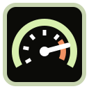
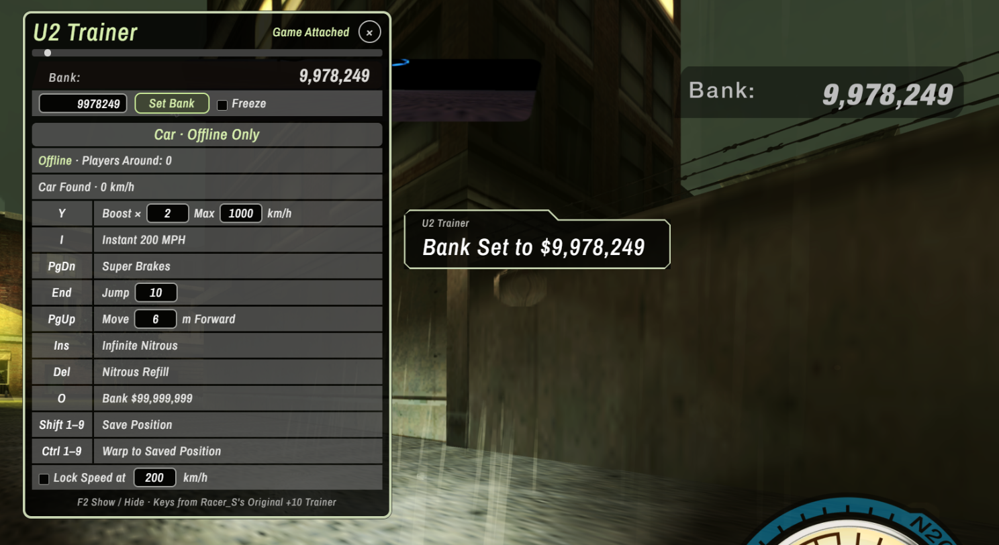
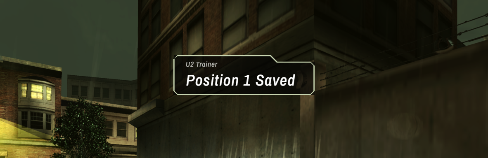

<p align="center">
  
</p>

<h1 align="center">U2 Revived Trainer</h1>

<p align="center">
  <b>The old-school +10 trainer, back for the browser.</b><br>
  Money, 200 mph launches, super brakes, jumps, infinite nitrous and warps for <a href="https://nfsu2.xyz/">Underground 2 Revived</a>, all from an in-game overlay styled like the game itself.
</p>

<p align="center">
  
  
  
  
</p>

> [!IMPORTANT]
> **Made specifically for Chromium browsers and [https://nfsu2.xyz/](https://nfsu2.xyz/).**
> It is built and tested on Chrome-based browsers (Chrome, Edge, Brave, Opera, Vivaldi) and only runs on the nfsu2.xyz browser remake. It does not work with the original PC game or any other port. The Firefox and Safari builds are provided as-is and are untested.

<p align="center">
  
</p>

---

## Why

Underground 2 was the game for a lot of us, and so were the little trainers we ran next to it: one keypress for cash, another to launch the car to 200 mph. The browser remake on nfsu2.xyz brought the game back. This brings the trainer back with it.

It keeps the exact key layout of **Racer_S's NFSU2 +10 Trainer** from the mid-2000s, so your fingers already know where everything is.

## Features

| Key | What it does |
|:---:|---|
| <kbd>Y</kbd> | **Boost**: multiplies your current speed (×2 by default, capped at a max you set) |
| <kbd>I</kbd> | **Instant 200 mph** in the direction you're facing |
| <kbd>PgDn</kbd> | **Super brakes**: stops the car dead, spin included |
| <kbd>End</kbd> | **Jump** (height adjustable) |
| <kbd>PgUp</kbd> | **Move forward** a few metres: pops you straight through red barriers and walls |
| <kbd>Insert</kbd> | **Infinite nitrous** on/off |
| <kbd>Delete</kbd> | **Nitrous refill** |
| <kbd>O</kbd> | **Bank to $99,999,999** |
| <kbd>Shift</kbd>+<kbd>1</kbd>–<kbd>9</kbd> | **Save** your position to a slot |
| <kbd>Ctrl</kbd>+<kbd>1</kbd>–<kbd>9</kbd> | **Warp** back to a saved position |
| <kbd>F2</kbd> | Show / hide the trainer panel |

The panel (<kbd>F2</kbd>) adds a **bank editor** (set any amount, optional freeze), a **speed lock** (hold the car at a fixed km/h), and live readouts for your bank and speed.

<p align="center">
  
</p>

## Fair play: car cheats are offline-only

nfsu2.xyz has shared free roam and online races with real people. Boosting through a lobby would ruin it for them, so:

- **Car cheats** (everything except money) only work after you press **Go offline** in the panel, and they switch themselves off the moment another player shows up.
- **Money** works any time, since your bank only affects your own career.
- When the cheats are off, their keys pass straight through to the game, so nothing interferes with normal play.

## Install

Grab the package for your browser from the [**Releases**](../../releases) page.

### Chromium (Chrome, Edge, Brave, Opera, Vivaldi): recommended

1. Download `u2-revived-trainer-chromium-vX.Y.Z.zip` and unzip it into a folder you'll keep.
2. Open `chrome://extensions` (or `edge://extensions`) and switch on **Developer mode**.
3. Click **Load unpacked** and select the folder.
4. Open [nfsu2.xyz](https://nfsu2.xyz/), start the game, and press <kbd>F2</kbd>.

### Firefox (experimental)

1. Download `u2-revived-trainer-firefox-vX.Y.Z.xpi`.
2. Open `about:debugging#/runtime/this-firefox` → **Load Temporary Add-on…** → pick the file.
3. Needs Firefox 128+. Temporary add-ons disappear when Firefox closes.

### Safari (experimental)

Safari needs extensions wrapped in a macOS app. Download `u2-revived-trainer-safari-vX.Y.Z.zip` and follow the `README.txt` inside (it uses Xcode's `safari-web-extension-converter`). The game itself officially targets Chrome and Firefox, so Safari may not run it at all.

## How it works

The remake on nfsu2.xyz is the original PC game's code statically recompiled to WebAssembly. That has a neat side effect: **the game keeps its original 2004 memory layout**, so the addresses classic trainers used still point at the same things, just inside the page's WebAssembly memory instead of a Windows process.

- A content script runs in the page's own JavaScript world (`"world": "MAIN"`) and reads the game's shared `WebAssembly.Memory` directly.
- **Bank** lives at `0x861E74`.
- **Your car** is found through a pointer chain, `[[0x89CDA8] + 0x20] − 0x30`. From there: position `+0x50`, forward vector `+0x60`, linear velocity `+0xA0`, angular velocity `+0xB0`.
- **Nitrous** sits at `[0x89CCF8] + 0x454` and `+0x45C`.
- The overlay is a Shadow DOM panel. Its styles go through a constructable stylesheet because the site's Content Security Policy blocks inline `<style>`.

No network requests, no permissions beyond running on `nfsu2.xyz`, no data collected.

## Build from source

```bash
./scripts/build.sh
```

It creates `dist/` with one package per browser, plus `SHA256SUMS.txt`. The shared code lives in `src/trainer.js`, and each browser's manifest is in `platform/<browser>/`.

## Credits

- **Racer_S**: the original *NFSU2 +10 Trainer*. The key layout and memory offsets come from it.
- The **[Underground 2 Revived](https://nfsu2.xyz/)** team, for bringing the game to the browser.
- **[Archivo Narrow](https://github.com/Omnibus-Type/ArchivoNarrow)** by Omnibus-Type, the overlay's font ([SIL OFL 1.1](src/fonts-OFL.txt)).

## Disclaimer

A fan-made tool for personal, single-player fun. Not affiliated with, endorsed by or connected to Electronic Arts, the Need for Speed franchise, or the nfsu2.xyz project. All trademarks belong to their owners. If nfsu2.xyz updates its build, addresses may shift and the trainer may need an update.

## License

[MIT](LICENSE)
